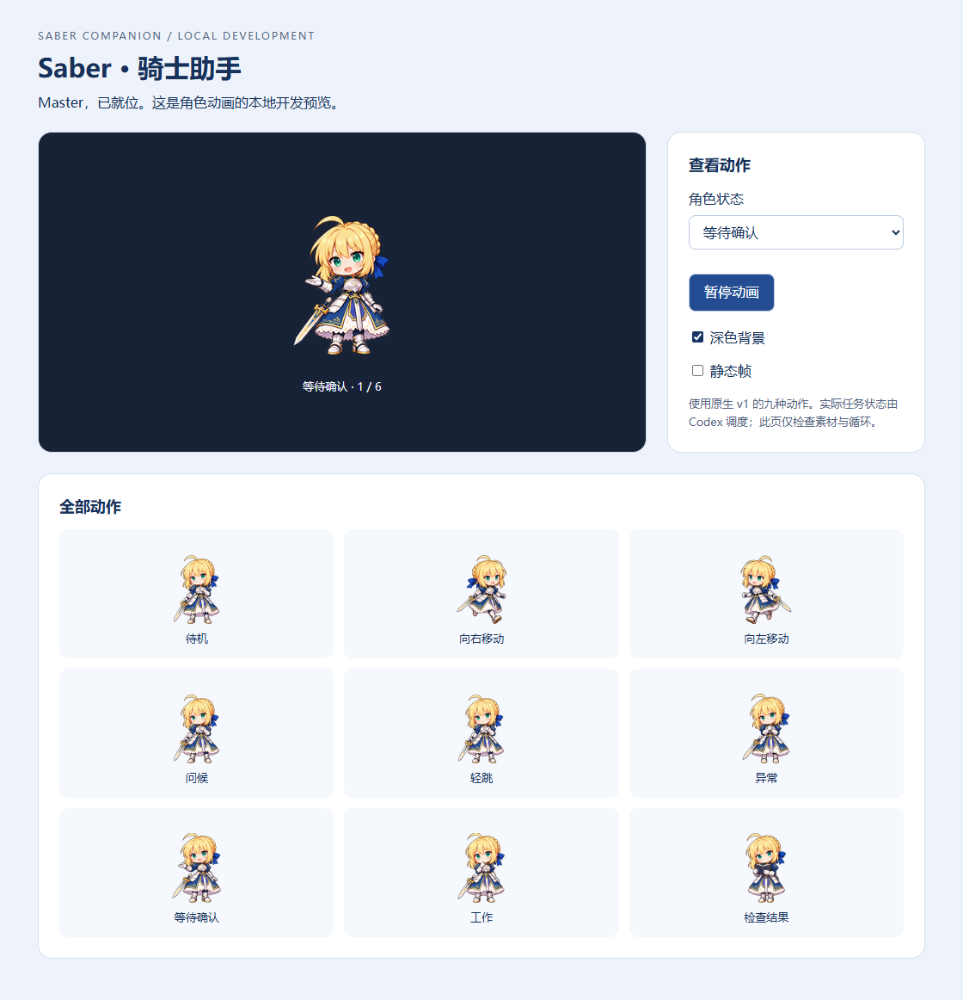

# Saber Companion

将 Saber 的角色风格与原生宠物资源安装到现有 Codex。当前为 Windows 预览版，包含两个技能与九种角色动作。

## 效果展示

### 角色动作


演示直接使用当前角色包的动画帧，依次播放问候、待机、向右移动、向左移动、轻跳、等待确认、工作、检查结果和异常九种动作。

### 本地预览工作台



工作台支持切换动作、暂停和继续、静态帧及深色背景。以上为角色素材和开发预览效果；原生悬浮窗与真实任务的状态联动仍待实测。

## 从 GitHub 安装

需要可用的 Codex CLI，以及支持自定义 Pets 的 Codex 桌面客户端。在 PowerShell 中执行：

```powershell
codex plugin marketplace add euansuuu/codex-saber --ref main
codex plugin add saber-companion@saber-local
```

新开聊天并输入：

```text
$saber-companion:saber-setup 请安装本机 Saber 角色
```

完成后在 **Settings → Pets → Refresh** 中选择 **Saber**，用 `/pet` 显示。使用骑士对话风格时输入 `$saber-companion:saber`。

角色素材已随插件打包，安装时无需重新生成图片，也无需安装构建用的 Python/Pillow。市场名称保留为 `saber-local`，与现有本地安装兼容。仓库安装功能基于 [Codex 官方插件机制](https://developers.openai.com/plugins/build/plugins)。

## 本地安装

在此目录执行：

```powershell
.\scripts\install-local.ps1
```

脚本注册本地市场 `saber-local`，安装 `saber-companion`，再将角色文件复制到当前 `CODEX_HOME/pets/saber-knight`。未设置 `CODEX_HOME` 时，使用用户目录下的 `.codex`。相同角色文件会跳过；已有不同内容会保留并报错，避免覆盖修改。

安装后在新聊天中输入 `$saber-companion:saber` 使用骑士风格，或 `$saber-companion:saber-setup` 检查本地角色设置。这两个名称已由本机桌面端的技能发现接口实际返回；也可在技能选择器中选择对应技能。

角色外观需在 **Settings → Pets → Refresh → Saber** 中选择，用 `/pet` 显示。插件风格与角色外观分别启用，动画切换由宿主负责。安装文件成功不代表界面已经选中角色。

## 动画预览

从本目录启动仅绑定本机的静态预览：

```powershell
python -m http.server 8000 --bind 127.0.0.1
```

打开 [Saber 动画工作台](http://127.0.0.1:8000/plugins/saber-companion/preview/)。此页面只用于检查动画素材，没有模型连接或聊天功能。

## 重新构建与验证

```powershell
python .\tools\build_pet.py
python -m unittest discover -s tests -v
```

构建需要 Python 和 Pillow。全部角色美术由内置 imagegen 根据参考图生成，提示词保存在 `plugins/saber-companion/assets/saber-poses-prompt.txt`。构建脚本负责把 12 个姿态机械编排为 57 帧，不调用模型或网络。首版使用姿态切换、小幅位移和旋转，后续可用逐帧原画改善步态和动作连续性。

原生素材为 v1：1536 × 1872，8 列 × 9 行，单格 192 × 208。包含待机、左右移动、问候、轻跳、异常、等待确认、工作、检查结果九种动作。v1 不包含鼠标方向追踪。

测试通过隔离的临时 Codex 配置验证插件真实安装，另验证精灵帧边界、透明空格、重复安装与已有修改保护；测试不调用模型推理。

本机验证（2026-10-24）：5 项自动测试通过；Edge 预览在 1120 × 900 和 390 × 844 下通过九种状态切换、暂停/继续、静态帧、减少动画与深色背景检查，控制台无错误。已完成当前用户的本地安装，桌面端的技能发现接口返回两个已启用的命名空间技能。

尚未在原生悬浮窗里验证真实任务状态联动，也未调用模型验证角色回复。角色外观仍需由用户在 Pets 中选中。

## 文件位置

- `.agents/plugins/marketplace.json`：本地市场。
- `plugins/saber-companion/`：插件、技能、原生角色及预览。
- `scripts/install-local.ps1`：本地安装入口。

插件遵循 [官方本地打包机制](https://developers.openai.com/plugins/build/plugins)。原生角色格式在本机 ChatGPT/Codex 桌面包 `26.1021.2667.0` 的资源读取与播放代码中核对，属于当前版本的兼容基线；升级后需复验。
