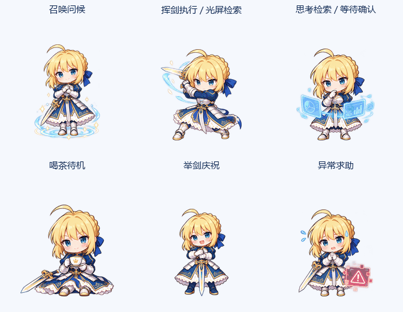

# Saber Companion

将 Saber 的角色风格与原生宠物资源安装到现有 Codex。当前为 Windows 预览版 0.2.0，包含两个技能与九种原生动作，补齐原设计的六类角色表演。

## 效果展示

### 角色动作



六类动作使用新增的 24 张绘制关键帧，手势、表情、茶杯、剑光和光屏会实际变化。上图同步展示素材循环，不代表原生窗口同时播放六个动作。

| 原设计 | 当前角色表演 | 原生触发 |
| --- | --- | --- |
| 初次启动 / 唤醒 | 魔法阵、行礼、挥手与伸手问候 | 首次唤醒 `waving` |
| 运行中 / 执行任务 | 挥剑、蓝色剑弧，接着查看检索光屏 | 聊天正在工作 `running` |
| 思考中 / 检索数据 | 托腮、查看图表、点击光屏 | `running` 的后半段；等待用户输入 `waiting` 也使用此组姿态 |
| 空闲 / 待命休息 | 举杯、喝茶、放杯微笑 | 无活动或一次动作播放结束后 `idle` |
| 任务完成 | 举剑、欢笑、星光与花瓣 | 任务完成且结果未读 `review` |
| 报错 / 异常 | 担忧、汗滴、警告光屏与求助手势 | 任务失败或系统错误 `failed` |

**鼠标停在原生角色上时，Codex 会优先显示跳跃。移开鼠标再观察任务动作；左右移动在拖动角色时触发。** 普通插件无法改变这项宿主播放规则。宿主也没有单独的“联网检索中”动作状态，因此检索动作按上表编排，不代表检测到了搜索工具调用。

全部九种动作的逐项演示：


演示直接使用当前角色包的动画帧，依次播放召唤问候、喝茶待机、向右移动、向左移动、轻跳、思考等待、挥剑与检索、举剑庆祝和异常求助。

### 本地预览工作台


工作台支持切换动作、暂停和继续、静态帧及深色背景。以上为角色素材和开发预览效果；用户已确认原生窗口显示新版动作，完整任务状态切换仍待验证。

## 从 GitHub 安装

需要可用的 Codex CLI，以及支持自定义 Pets 的 Codex 桌面客户端。在 PowerShell 中执行：

```powershell
codex plugin marketplace add euansuuu/codex-saber --ref main
codex plugin add saber-companion@saber-local
```

新开聊天并输入：

```text
$saber-companion:saber-setup 请安装本机 Saber 角色
```

完成后在 **Settings → Pets → Refresh** 中选择 **Saber**，用 `/pet` 显示。使用骑士对话风格时输入 `$saber-companion:saber`。

角色素材已随插件打包，安装时无需重新生成图片，也无需安装构建用的 Python/Pillow。市场名称保留为 `saber-local`，与现有本地安装兼容。仓库安装功能基于 [Codex 官方插件机制](https://developers.openai.com/plugins/build/plugins)。

## 本地安装

在此目录执行：

```powershell
.\scripts\install-local.ps1
```

脚本注册本地市场 `saber-local`，安装 `saber-companion`，再将角色文件复制到当前 `CODEX_HOME/pets/saber-knight`。未设置 `CODEX_HOME` 时，使用用户目录下的 `.codex`。相同角色文件会跳过；已有不同内容会保留并报错，避免覆盖修改。

已有首版角色时，执行带备份的本地升级：

```powershell
.\scripts\install-local.ps1 -Upgrade
```

升级会先将旧 `pet.json` 与精灵表完整备份到 `CODEX_HOME/pets-backups/saber-knight/<时间与随机后缀>/`，再替换角色文件。随后在 **Settings → Pets → Refresh** 中重新选择 **Saber**。刷新前原生窗口可能仍缓存旧图。

### 已迁移到云端 Pets 的角色

新版桌面端可能已将本地 Saber 迁移到 ChatGPT Pets 云端库。**更新本地文件不会更新已经迁移的云端角色，Refresh 也不会替换云端图片。** 安装脚本检测到迁移记录后会明确提示。

此时在已连接 Pets 插件的聊天中输入：

```text
$saber-companion:saber-setup 请同步当前正在使用的 Saber 到本插件新版素材，保留现有角色 ID 和选中状态
```

同步应验证云端自定义角色身份，校验并更新同一 ID 的素材，最后下载云端精灵表比较 RGBA 像素；不要重复创建角色。没有 Pets 工具时，安装技能应说明云端同步尚未完成。

“正在思考”与执行工具共用原生 `running` 行。当前宿主只播放约 2.46 秒后就返回 `idle`，任务文字仍可能显示“正在思考”；这项持续播放限制不能通过本插件的 `animation.json` 更改。

安装后在新聊天中输入 `$saber-companion:saber` 使用骑士风格，或 `$saber-companion:saber-setup` 检查本地角色设置。这两个名称已由本机桌面端的技能发现接口实际返回；也可在技能选择器中选择对应技能。

角色外观需在 **Settings → Pets → Refresh → Saber** 中选择，用 `/pet` 显示。插件风格与角色外观分别启用，动画切换由宿主负责。安装文件成功不代表界面已经选中角色。

## 动画预览

从本目录启动仅绑定本机的静态预览：

```powershell
python -m http.server 8000 --bind 127.0.0.1
```

打开 [Saber 动画工作台](http://127.0.0.1:8000/plugins/saber-companion/preview/)。此页面只用于检查动画素材，没有模型连接或聊天功能。

## 重新构建与验证

```powershell
python .\tools\build_pet.py
python -m unittest discover -s tests -v
```

构建需要 Python 和 Pillow。全部角色美术由内置 imagegen 根据参考图生成；首版提示词保存在 `plugins/saber-companion/assets/saber-poses-prompt.txt`，新增六组动作的完整提示词保存在同目录的 `saber-action-prompts.json`。构建脚本读取首版姿态与六张 2 × 2 关键帧图集，编排为 57 帧，不调用模型或网络。六类原设计动作使用绘制关键帧；左右移动和鼠标悬停轻跳沿用首版素材。当前仍为有限关键帧动画，没有为每帧绘制完整的中间过渡。

原生素材为 v1：1536 × 1872，8 列 × 9 行，单格 192 × 208。九行次序与 Codex 原生格式一致；`review` 表示任务完成待阅读，使用举剑庆祝。v1 不包含鼠标方向追踪。一次非待机动作按当前宿主逻辑播放三遍后返回待机，预览页则持续循环所选动作。

测试通过隔离的临时 Codex 配置验证插件真实安装，另验证关键帧重建、六类动作差异、缺帧拒绝、精灵帧边界、透明空格、重复安装、已有修改保护与升级备份；测试不调用模型推理。

本机验证（2026-10-25）：9 项自动测试通过；Edge 预览在 1120 × 900 和 390 × 844 下通过九种状态切换、六类动作连续播放、暂停/继续、静态帧、减少动画与深色背景检查，控制台无错误。0.2.0 已安装到当前用户，角色文件、插件缓存与仓库一致，0.1.0 精灵表已完整备份。新增测试验证已迁移角色的安装提示，并确保不改写账号状态文件。

本机实际选中的云端 Saber 曾与 0.1.0 逐像素相同。现已通过 Pets 正式校验并同步到 0.2.0，保留稳定角色 ID、名称与选中状态，云端回读的 RGBA 像素与本地一致。用户已确认原生窗口显示新版动作。尚未验证所有任务状态的完整切换，也未调用模型验证角色回复；长时间思考动画仍受上述宿主限制。

## 文件位置

- `.agents/plugins/marketplace.json`：本地市场。
- `plugins/saber-companion/`：插件、技能、原生角色及预览。
- `scripts/install-local.ps1`：本地安装入口。

插件遵循 [官方本地打包机制](https://developers.openai.com/plugins/build/plugins)。原生角色格式及悬停优先级、任务映射和动作结束行为在本机 ChatGPT/Codex 桌面包 `26.1021.3705.0` 的读取与播放代码中核对，属于当前版本的兼容基线；升级后需复验。实际任务状态的含义参见 [OpenAI 官方 Pets 说明](https://learn.chatgpt.com/docs/pets)。
